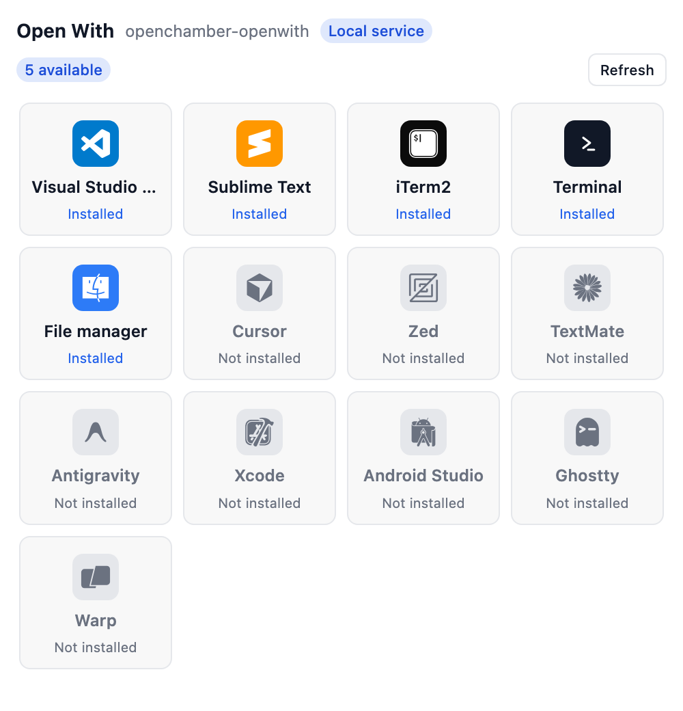

<div align="center">

# OpenChamber Open With

**Open your project in another app from [OpenChamber](https://openchamber.dev).**
The rail panel lists your editors, terminals and file managers — the ones you
have installed are in colour, the rest are greyed out — and one click opens the
project you have open in the app you pick.

English · [简体中文](./README.zh-CN.md)

[](./LICENSE)
[](https://openchamber.dev)
[](#languages)



</div>

The panel shows every app it knows about. Apps found on your machine are drawn in
their brand colour; the ones that are not installed are greyed out. Click an
installed app and the project OpenChamber has open is opened in it.

> Built as an OpenChamber **extension** (rail panel + local service), not an
> OpenCode plugin.

## Contents

- [Features](#features)
- [How it works](#how-it-works)
- [Install](#install)
- [Usage](#usage)
- [Permissions](#permissions)
- [Limitations](#limitations)
- [Development](#development)
- [Languages](#languages)
- [License](#license)

## Features

- **One click to open** — the open project is handed to the app you pick.
- **Installed first, at a glance** — detected apps keep their brand colour and
  are listed first; the rest are greyed out, so you only click what is really
  there.
- **Editors, terminals, file managers** — VS Code, Cursor, Zed, Sublime Text,
  TextMate, Antigravity, Xcode, Android Studio, Terminal, iTerm2, Ghostty, Warp,
  and the platform's file manager (Finder / File Explorer / Files).
- **Your own web links** — save URL templates such as
  `https://example.com/?path={path}` and open the project on that page;
  `{path}` and `{pathUrlEncode}` are filled with the project directory.
- **Per-platform detection** — `.app` bundles and PATH on macOS; PATH on Windows
  and Linux.
- **Refresh on demand** — re-check the machine after you install something.
- **A log you can read later** — the service writes to
  `~/.config/openchamber-openwith/logs/service.log` (10 MB, rolling), so a failed
  launch can be inspected after the fact.
- **Localized panel** — follows the OpenChamber language (English, 简体中文,
  繁體中文).
- **No project pollution** — nothing is written into the project.

## How it works

The iframe cannot start a process, so the extension ships a **local service**
(`contributes.service`). The host spawns it once the user approves it; the panel
only talks to it through `serviceRequest`.

```
panel (iframe) --serviceRequest--> host --127.0.0.1:port--> service --spawn--> open -a "<app>" <project>
```

- **`GET /apps`** detects which apps are installed. On macOS an app counts as
  installed when its `.app` bundle sits in `/Applications`, `/System/Applications`
  or `~/Applications`, or when its command is on PATH; on Windows and Linux the
  command is looked up with `where` / `which`. The result is cached for a short
  while, and `?refresh=1` re-checks on demand.
- **`POST /open`** validates the project directory and the app, then launches it.
  On macOS an editor is opened with its own CLI (`code`, `cursor`, `zed`,
  `subl <directory>`), which opens the folder in a running instance and raises
  its window; everything else uses `open -a "<name>" <directory>`. On Windows and
  Linux the app's command is run with the directory (a Windows `.cmd` launcher,
  such as VS Code's `code`, is run through `cmd`, since a batch file cannot be
  started directly). The child is detached, so
  the service never waits on an editor you keep open, and the launcher's exit
  code is checked, so a failure is reported instead of a false success.

Every step is written to `~/.config/openchamber-openwith/logs/service.log`
(10 MB, rolling, three backups) as well as stderr, so a failed launch can be read
after the fact.

The catalog itself (ids, names, icons, which command to use) lives in
`src/apps.ts`, shared by the panel and the service. The panel never sees the
filesystem or PATH; the service never draws anything.

Custom web links skip the service: the panel fills the template with the project
directory and hands the finished URL to the host (`openUrl`), which opens it in
the browser. The templates are kept in the extension's own storage, so they work
while the service is off and never touch the project files.

## Install

OpenChamber **2.0.0 or newer**, web or desktop.

1. **Settings → Extensions**.
2. Paste one of these into **folder, ZIP or URL** and press **Add**:
   - the latest packaged zip — this URL always points at the newest build:
     `https://github.com/open-tecmz/openchamber-openwith/releases/latest/download/openchamber-openwith-latest.zip`
   - the `.zip` file from the latest **Releases** page,
   - the `dist/` folder of a local clone (run `make build` or `npm run build`
     once first),
   - the git URL of the `release` branch —
     `https://github.com/open-tecmz/openchamber-openwith.git#release`
     (git installs can **Update** from Settings → Extensions when `package.json`
     version increases; a zip install cannot, so re-add the newer zip by hand).
3. Approve the permission dialog (**Allow and enable**). It lists the local
   service, which runs `open` and the app commands with your full user rights.

## Usage

Open the **Open With** panel from the extensions area of the rail:

1. The panel follows the project you have open and lists the apps it knows.
2. Apps found on your machine are in colour and clickable; the rest are greyed
   out and disabled.
3. Click an installed app: the project is opened in it and a toast confirms.
4. Press **Refresh** after installing a new app to detect it.

`contributes.page` also opens the same panel full-screen.

### Custom web links

Link tiles sit in the same grid as the apps, after the installed ones. Press the
dashed **Add link** tile (or the pencil on an existing link tile) to open the
editor dialog; give the link a name (optional) and enter a template. You can keep
up to eight links, each with its own tile. Two placeholders are filled from the
project OpenChamber has open:

- `{path}` — the project directory exactly as reported (raw, so a path with `&`,
  `#` or `?` can break a query value);
- `{pathUrlEncode}` — the same directory through `encodeURIComponent`, which is
  what a query value should use.

So `https://example.com/?path={pathUrlEncode}` becomes
`https://example.com/?path=%2FUsers%2Fyou%2Fproject`, while
`https://example.com/?path={path}` keeps the slashes readable. Click a link tile
to open it in your browser; the pencil in its corner opens the same dialog to
edit or delete it. Up to eight links are kept in the extension's own storage, so
they survive restarts and follow every project. Opening a link needs no local
service, so the link tiles stay usable while the service is off.

## Permissions

| Capability | Why |
| --- | --- |
| `service` | the local service detects installed apps and starts the one you pick; it runs with your full user rights |

The service declares `permissions.exec` with the launchers it may run — `open`
plus the app commands, the `which` / `where` lookup and, on Windows, `cmd` (the
editor launchers are `.cmd` files there) — so the approval dialog says what it
intends to run. The extension asks for no other capability: it reads
no session data and no project files. The custom web links live in the
extension's own storage, which needs no extra capability.

## Limitations

- **The local service must be approved** — without it the panel cannot look at
  your machine or start a process, and it says so.
- **Cold start** — OpenChamber spawns the service on demand, so after the
  OpenChamber process restarts the panel shows “connecting” until the first
  request brings the service back.
- **Detection is a best-effort scan** — an app installed somewhere unusual may
  show as not installed. An editor's command on PATH still counts, so installing
  the `code`-style launcher is enough to make it appear.
- **Different apps per platform** — the list is macOS-first; Windows and Linux
  get the editors that ship a command there.
- **Non-public process access** — the service runs under your account with no OS
  sandbox, exactly as the approval dialog warns.
- Extensions do not load in VS Code or the mobile app, so this one does not
  either.

## Development

```bash
npm install
make build          # assembles the installable package into dist/
make typecheck
make test           # builds, then runs the service test and the i18n test
```

`npm run build` (or `make build`) writes the whole installable package to
`dist/`: `dist/package.json`, `dist/icon.svg`, `dist/panel/index.html`, and the
two bundles `dist/panel/main.js` (browser IIFE) + `dist/service/main.js` (Node
ESM). The host loads built `.js` files as they sit in the package, so the page
and its bundle must stay in the same folder. `dist/` is generated and **not
committed**; CI builds it on every push to `main`.

To run your build while developing, folder-install `dist/` (Settings →
Extensions): it runs from your folder, so edit, rebuild, and reload.

The host never compiles an extension: ship built files only. Editing
`src/i18n.ts` and rebuilding is enough to add a language. These are the only
`devDependencies`; nothing here ships `node_modules`. Record every change in
`changelog.md` before you finish — the repo rule lives in `AGENTS.md`.

## Languages

The panel follows the OpenChamber language and falls back to English. Panel copy
ships in `en`, `zh-cn` and `zh-tw`; add one by extending `DICTIONARIES` in
`src/i18n.ts` — the dictionary type makes a missing key a compile error. This
documentation ships in English (this file) and 简体中文
([README.zh-CN.md](./README.zh-CN.md)).

## License

[Apache-2.0](./LICENSE). Most app icons come from
[Simple Icons](https://simpleicons.org) (CC0-1.0); TextMate and Finder come from
[File Icons](https://github.com/file-icons/icons) (ISC), Antigravity from Google's
press kit, and Terminal is the macOS Terminal mark. The brand marks belong to
their owners.
